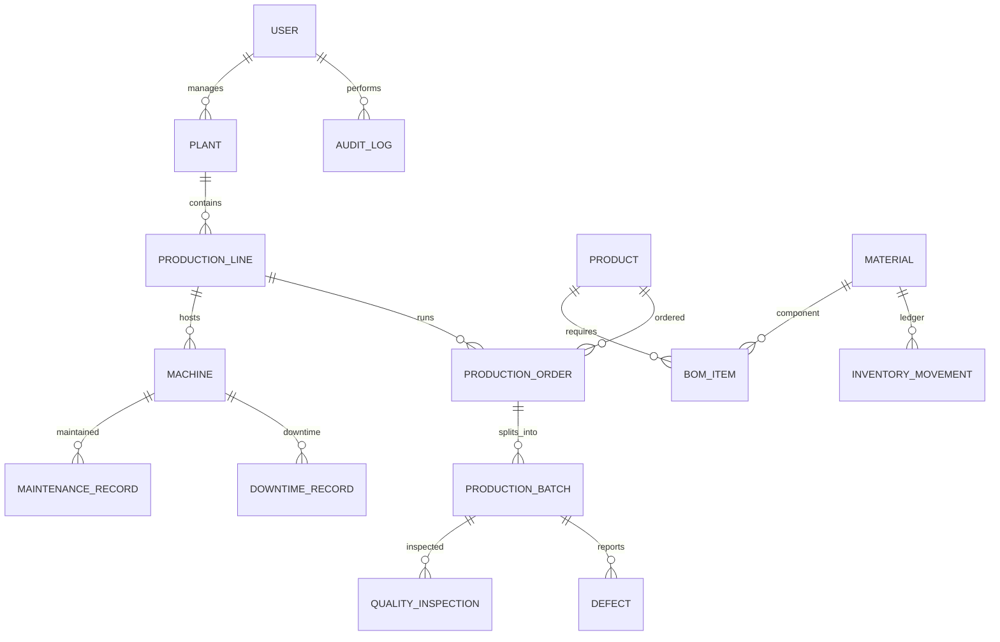

# Manufacturing Production & Quality Control Management System

FastAPI starter backend covering authentication/RBAC, plants, production lines, products, materials, BOM, machines, production orders and batches, quality inspections, defects, inventory movement, maintenance, downtime, dashboard, reports, notifications and audit logs.

## Windows quick start
```powershell
py -3.11 -m venv .venv
.\.venv\Scripts\Activate.ps1
python -m pip install --upgrade pip
pip install -r requirements.txt
Copy-Item .env.example .env
uvicorn app.main:app --reload
```
Open http://127.0.0.1:8000/docs. SQLite is default for local development. Edit DATABASE_URL in `.env` for MySQL/PostgreSQL.

## Docker
Set DATABASE_URL in `.env` to `mysql+pymysql://manufacturing_user:manufacturing_password@db:3306/manufacturing_db`, then `docker compose up --build`.

## Swagger/Postman
Register a development user at `/api/v1/auth/register`. Login at `/api/v1/auth/login` with form fields `username` (email) and `password`. Copy `access_token`, click Authorize in Swagger and enter `Bearer <token>`. Import `postman/Manufacturing_API.postman_collection.json` into Postman. For production, public registration must not allow users to self-assign privileged roles.

## Key business logic included
- JWT access/refresh tokens, password hashing, current-user, activation/deactivation and role guards
- Plant and line creation/search/filter/pagination; product/material catalog; versioned BOM items
- Machine status transition validation
- Production order status transitions, active BOM and material availability checks before start
- Batch creation/start/output/completion checks, completion/rejection percentages
- Quality pass/fail inspection; defect severity and critical-defect notifications
- Stock-in/out/adjustment ledger with negative-stock prevention
- Maintenance scheduling, due maintenance, downtime records
- Dashboard metrics, production report, audit logs, low-stock/breakdown/quality notifications
- Soft-delete fields, database indexes and Pydantic validation

## Migrations and tests
```powershell
alembic revision --autogenerate -m "initial schema"
alembic upgrade head
pytest -q
```
Alembic environment is included. The app currently uses `create_all()` for easy first run; switch to migration-only startup for deployment.

## Suggested end-to-end flow
Admin register/login -> plant -> line -> product -> material -> BOM -> stock-in -> machine -> order -> Draft to Scheduled -> check stock and transition to In Progress -> batch -> start -> record output -> inspection -> defect if needed -> complete batch -> manager approval -> complete order -> dashboard/report/audit log.

## Important scope note
This is a functional starter scaffold, not a fully audited production-ready application. To meet every line of the assignment, extend it with password-reset/activation email flows, refresh-token rotation and server-side revocation, worker and shift management/assignments, material consumption posting and finished-goods ledger, dedicated supervisor review, full CRUD/update/delete endpoints, comprehensive daily/monthly/machine/product/worker/shift/downtime reports, rate limiting, notification delivery, exports, CI/CD, and comprehensive unit/integration tests. Verify workflow and permissions with tests before submission. Replace the sample secret and restrict CORS before deployment.

## ER diagram

